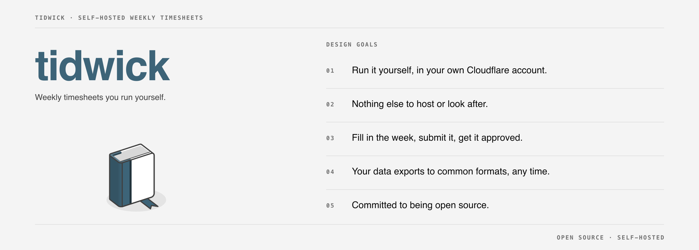

# tidwick

Weekly timesheets for professional-services firms, running on Cloudflare Workers, D1 and R2. A technical person deploys it into the firm's own Cloudflare account; nobody hosts it. Version 0, author-tested only.

| Repo | What it is |
|---|---|
| [tidwick](https://github.com/tidwick/tidwick) | The app: week grid, approvals, audit log, CSV export and import, passkey login. |
| [tidwick.dev](https://github.com/tidwick/tidwick.dev) | The project site. |

- Site: [tidwick.dev](https://tidwick.dev)
- Demo: [demo.tidwick.dev](https://demo.tidwick.dev) (resets nightly)
- Bugs and questions: [Issues](https://github.com/tidwick/tidwick/issues) and [Discussions](https://github.com/tidwick/tidwick/discussions) on tidwick/tidwick

AGPL-3.0.
